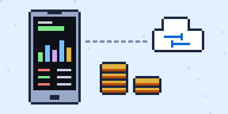
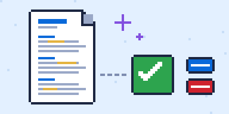
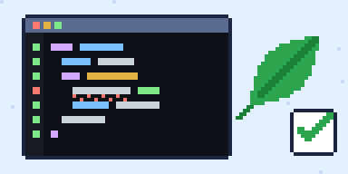
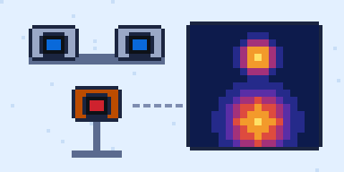

<picture>
  <source media="(prefers-color-scheme: dark)" srcset="assets/banner-dark.svg">
  <source media="(prefers-color-scheme: light)"
    srcset="assets/banner-light.svg">
  
</picture>

<h1>Kevin Elihan Muñoz Calva</h1>

<b>Ingeniero de software que construye productos de punta a punta: 
app móvil, backend, infraestructura y herramientas de IA.</b>

Cofundador y tech lead de <a href="https://sotita.com">Sotita</a> ·
Máster en Gestión y Dirección de Proyectos en la UPV · De Ecuador

<b>Abierto a oportunidades</b> en ingeniería de software y gestión de
proyectos.

<a href="README.md">Read in English</a>

##  Ahora

- **Sotita** está en beta con testers.
  <!-- TODO: métrica (número de beta testers, descargas o usuarios activos) -->
- **CV Adapter** se prepara para ser open source.
- **Máster en Gestión y Dirección de Proyectos**: aprendo a planificar y
  dirigir el tipo de proyectos que ya construyo.

##  Proyectos destacados

<table>
<tr>
<td width="50%" valign="top">
  <picture>
    <source media="(prefers-color-scheme: dark)"
      srcset="assets/projects/sotita-dark.svg">
    <source media="(prefers-color-scheme: light)"
      srcset="assets/projects/sotita-light.svg">
    
  </picture>
  <h3><a href="https://sotita.com">Sotita</a></h3>
  App de finanzas personales · cofundador y tech lead · en beta ·
  código privado
  
<b>Problema:</b> registrar un gasto no debería depender de tener
  conexión.

  
<b>Solución:</b> una app Flutter offline-first. El núcleo financiero
  funciona sobre una base SQLite local y se sincroniza con un backend
  Supabase self-hosted mediante PowerSync. Un Cloudflare Worker ejecuta
  tareas programadas (transacciones recurrentes, cuotas de tarjeta, alertas
  de presupuesto) y envía notificaciones push. Desarrollo, staging y
  producción corren en Docker con Dokploy; los secretos viven en
  Infisical.

  
<code>Flutter</code> <code>Dart</code> <code>Riverpod</code>
  <code>Drift</code> <code>Supabase</code> <code>PostgreSQL</code>
  <code>PowerSync</code> <code>Cloudflare Workers</code>
  <code>TypeScript</code> <code>Astro</code> <code>Docker</code>
  <code>Dokploy</code> <code>Infisical</code>

</td>
<td width="50%" valign="top">
  <picture>
    <source media="(prefers-color-scheme: dark)"
      srcset="assets/projects/cv-adapter-dark.svg">
    <source media="(prefers-color-scheme: light)"
      srcset="assets/projects/cv-adapter-light.svg">
    
  </picture>
  <h3>CV Adapter</h3>
  <!-- TODO: enlace al repo público de CV Adapter -->
  Herramienta de IA que adapta mi CV a cada vacante · personal · corre
  en local · código próximamente
  
<b>Problema:</b> adaptar el CV a cada oferta lleva tiempo, y las
  herramientas de IA tienden a inventar experiencia.

  
<b>Solución:</b> toda mi experiencia vive en un único archivo
  estructurado. Para cada oferta, Claude elige lo relevante y lo reescribe
  con el vocabulario de la vacante. Un validador comprueba cada línea contra
  logros, cifras y skills reales; si algo falla, el modelo recibe los
  errores y repara el CV. La app genera un DOCX y un PDF de una columna,
  relee el PDF como un ATS e informa de la cobertura de keywords.

  
<code>Python</code> <code>FastAPI</code>
  <code>JavaScript vanilla</code>
  <code>API de Claude (tool use forzado)</code> <code>JSON Schema</code>
  <code>python-docx</code> <code>ReportLab</code> <code>Docker</code>

</td>
</tr>
<tr>
<td width="50%" valign="top">
  <picture>
    <source media="(prefers-color-scheme: dark)"
      srcset="assets/projects/spring-validator-dark.svg">
    <source media="(prefers-color-scheme: light)"
      srcset="assets/projects/spring-validator-light.svg">
    
  </picture>
  <h3><a href="https://github.com/kevelmun/spring-boot-validator">Spring
  Boot Syntax Validator</a></h3>
  Proyecto personal · código público
  
<b>Problema:</b> pasar de Laravel o Express a Spring Boot obliga a
  aprender muchas convenciones a la vez, sin nadie que revise tu
  código.

  
<b>Solución:</b> 15 ejercicios con tres capas de feedback: checks
  estructurales sobre el árbol de sintaxis real (JavaParser), compilación
  real con <code>javac</code> embebido y un linter de errores típicos de
  Spring.

  
<code>Java 21</code> <code>Spring Boot</code> <code>JavaParser</code>
  <code>React</code> <code>Vite</code> <code>Tailwind CSS</code>
  <code>CodeMirror</code> <code>Docker</code>

</td>
<td width="50%" valign="top">
  <picture>
    <source media="(prefers-color-scheme: dark)"
      srcset="assets/projects/stereothermal-dark.svg">
    <source media="(prefers-color-scheme: light)"
      srcset="assets/projects/stereothermal-light.svg">
    
  </picture>
  <h3><a href="https://github.com/kevelmun/StereoThermal">StereoThermal</a></h3>
  Proyecto de investigación · visión por computadora
  
<b>Problema:</b> combinar imágenes de color y térmicas exige
  fotogramas capturados en el mismo instante y alineados entre sí.

  
<b>Solución:</b> captura sincronizada de dos cámaras estéreo y una
  térmica, y registro de imágenes con LightGlue.

  
<code>Python</code> <code>OpenCV</code> <code>LightGlue</code>
  <code>Jupyter</code>

</td>
</tr>
</table>

##  Stack

<picture>
  <source media="(prefers-color-scheme: dark)"
    srcset="https://skillicons.dev/icons?i=flutter%2Cdart%2Csupabase%2Cpostgres%2Cts%2Cpython%2Cfastapi%2Cphp%2Claravel%2Cdocker%2Ccloudflare%2Creact&theme=dark">
  <source media="(prefers-color-scheme: light)"
    srcset="https://skillicons.dev/icons?i=flutter%2Cdart%2Csupabase%2Cpostgres%2Cts%2Cpython%2Cfastapi%2Cphp%2Claravel%2Cdocker%2Ccloudflare%2Creact&theme=light">
  
</picture>

<table>
<tr>
  <td><b>Móvil</b></td>
  <td><code>Flutter</code> <code>Dart</code> <code>Riverpod</code>
  <code>Drift</code> · también <code>Ionic</code></td>
</tr>
<tr>
  <td><b>Backend y datos</b></td>
  <td><code>TypeScript</code> <code>Python</code> <code>FastAPI</code>
  <code>PHP</code> <code>Laravel</code> <code>Java</code>
  <code>Spring Boot</code> <code>PostgreSQL</code> <code>Supabase</code>
  <code>PowerSync</code> <code>SQLite</code></td>
</tr>
<tr>
  <td><b>Frontend</b></td>
  <td><code>React</code> <code>Astro</code> <code>Tailwind CSS</code>
  <code>JavaScript vanilla</code> · también <code>Angular</code></td>
</tr>
<tr>
  <td><b>Infraestructura</b></td>
  <td><code>Docker</code> <code>Dokploy</code>
  <code>Cloudflare Workers</code> <code>Infisical</code> <code>Caddy</code>
  <code>Nginx</code></td>
</tr>
<tr>
  <td><b>IA y visión por computadora</b></td>
  <td><code>API de Claude</code> <code>Ollama</code>
  <code>Azure Speech</code> <code>OpenCV</code> <code>Open3D</code>
  <code>LightGlue</code></td>
</tr>
<tr>
  <td><b>Videojuegos</b></td>
  <td><code>Godot</code> <code>Unity</code></td>
</tr>
</table>

##  Más allá del código

- **Cómo trabajo:** en Sotita, cada funcionalidad empieza como una spec
  numerada con sus decisiones por escrito, y se entrega como un slice vertical
  pequeño.
- **Lo divertido son los problemas que aún no sé resolver.** Ejemplo: el
  validador de Spring Boot compila código que usa Lombok sin su procesador de
  anotaciones; genera los métodos que faltan directamente en el árbol de
  sintaxis.
- **Más investigación:** convertir nubes de puntos 3D en datasets de imágenes
  para estimar la madurez de la fruta
  ([Fruit-Ripeness](https://github.com/kevelmun/Fruit-Ripeness)) y un asistente
  de voz con Azure Speech y Ollama
  ([VoiceChat-AzureOllamaAgent](https://github.com/kevelmun/VoiceChat-AzureOllamaAgent)).
- **Videojuegos:** [Scape from the Dark](https://kevelmun.itch.io/scape-from-the-dark),
  un juego universitario en equipo hecho en Godot.

##  Contacto

La forma más rápida de contactarme es por correo:
[3lihan.m.c@gmail.com](mailto:3lihan.m.c@gmail.com). También estoy en
[LinkedIn](https://www.linkedin.com/in/kevelmun) y en
[kevelmun.dev](https://kevelmun.dev).

<picture>
  <source media="(prefers-color-scheme: dark)" srcset="assets/footer-dark.svg">
  <source media="(prefers-color-scheme: light)"
    srcset="assets/footer-light.svg">
  
</picture>
